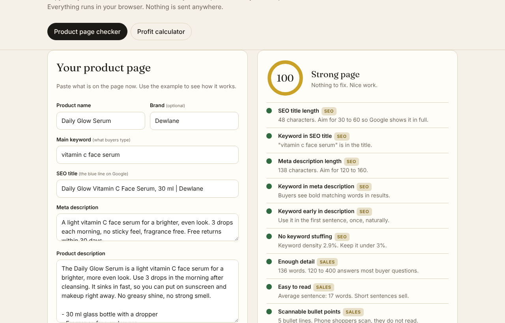
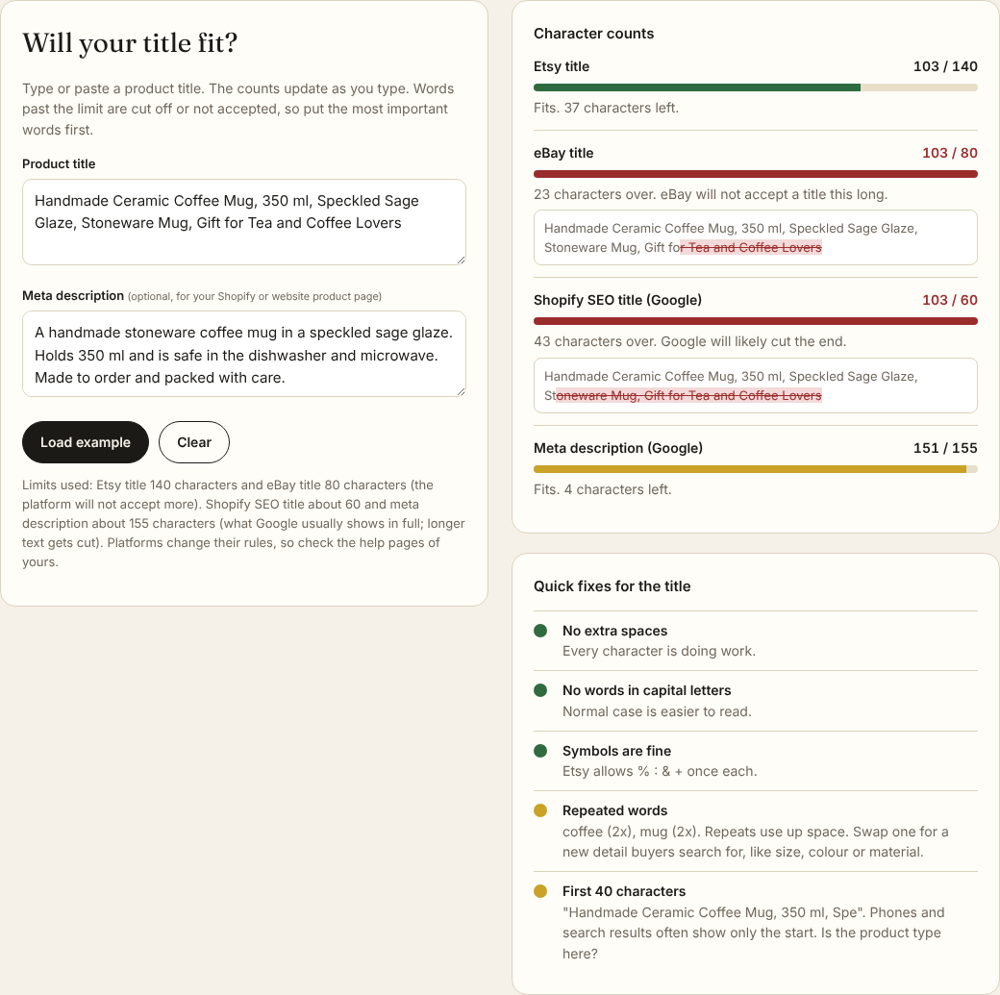
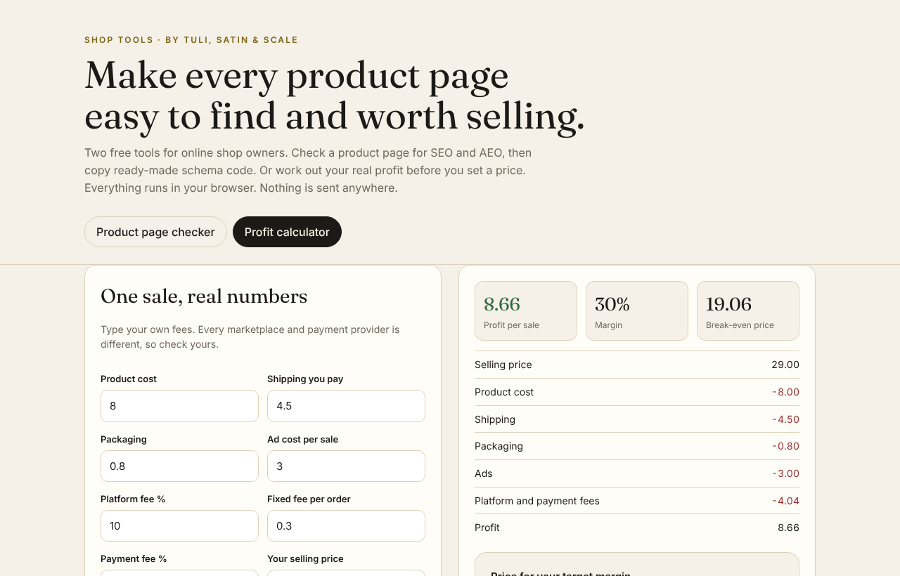

# Shop Tools

**Free tools for online shop owners. Check a product page for SEO and AEO, check if your titles fit Etsy, eBay and Google, and see your real profit per sale.**

**Live demo:** https://legacyroar7-maker.github.io/shop-tools/

## What it does

### 1. Product page checker (SEO + AEO)
Paste your product name, keyword, SEO title, meta description, description and FAQ. You get:

- **A score out of 100** with a clear list of what to fix first
- **SEO checks:** title and meta length, keyword in the right places, no keyword stuffing
- **Sales checks:** enough detail, short sentences, bullet points, real facts and numbers
- **AEO checks:** questions and answers that AI assistants (like ChatGPT) can quote, with direct first sentences
- **A Google preview** of how the page looks in search results
- **Ready-made schema code** (Product + FAQPage, JSON-LD) to paste into Shopify or any shop

### 2. Marketplace title checker (new)
Type or paste a product title. Live character counts show if it fits:

| Where | Limit | What happens if it is longer |
|---|---|---|
| Etsy title | 140 characters | Etsy will not accept it |
| eBay title | 80 characters | eBay will not accept it |
| Shopify SEO title | about 60 characters | Google usually cuts the end |
| Meta description | about 155 characters | Google usually cuts the end |

The part that does not fit is shown crossed out, so you see exactly which words buyers lose. You also get quick fixes: extra spaces, too many words in CAPITALS (Etsy allows 3), symbols used twice (Etsy allows % : & + once each), repeated words, and a look at your first 40 characters.

Tip: put the product type and the words buyers search for first. Limits can change, so check your platform's help pages too.

### 3. Profit calculator
Type your product cost, shipping, packaging, ads and fees. You get:

- Profit per sale and margin
- Break-even price
- The exact price you need for your target margin

## Why I built it
Most shop owners guess. They write product pages without checking them, and they set prices without counting every fee. This tool makes both checks take one minute.

## Privacy
Everything runs in your browser. No sign-up, no tracking, nothing is sent to a server.

## Tech
One HTML file, plain JavaScript, no frameworks, no build step. Hosted free on GitHub Pages. Works on phones.

## Use it
Open the live demo, press **Load example** to see how it works, then paste your own page.

---
Built by **Tuli, Satin & Scale**. I build Shopify stores, write product pages with SEO and AEO, make AI product videos and build web apps for shops.

Want this done for your shop or deck? I do it as a fixed-price project on Upwork: [Hire me on Upwork](https://www.upwork.com/freelancers/~01c18d191d6a95988c)
