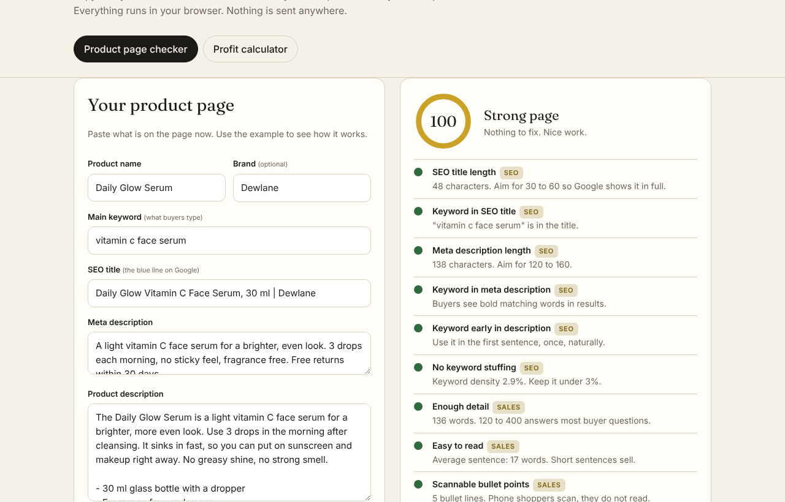
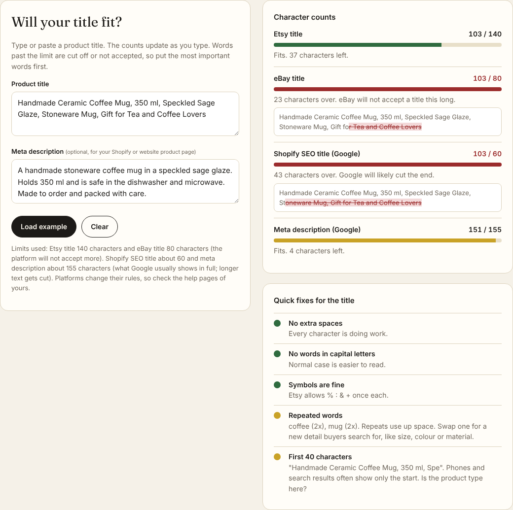
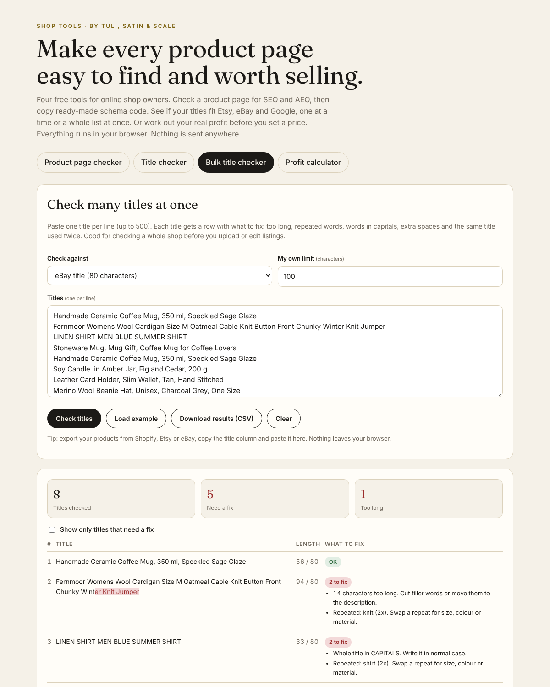
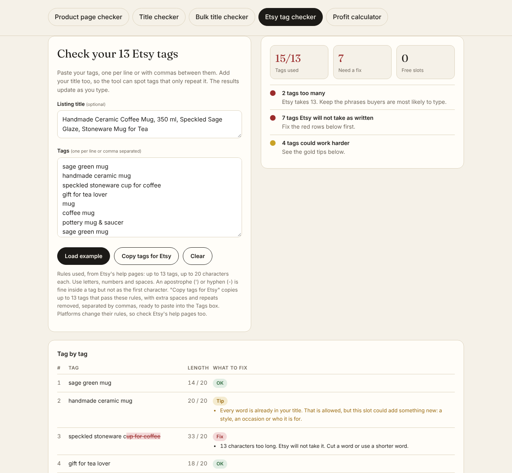
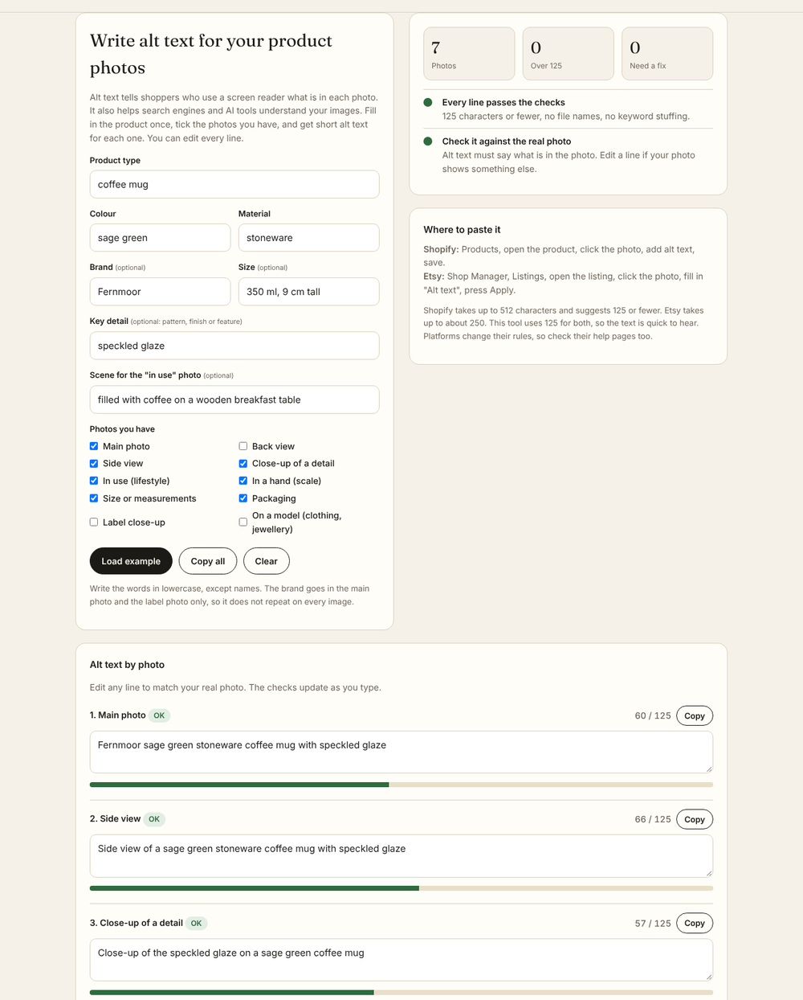
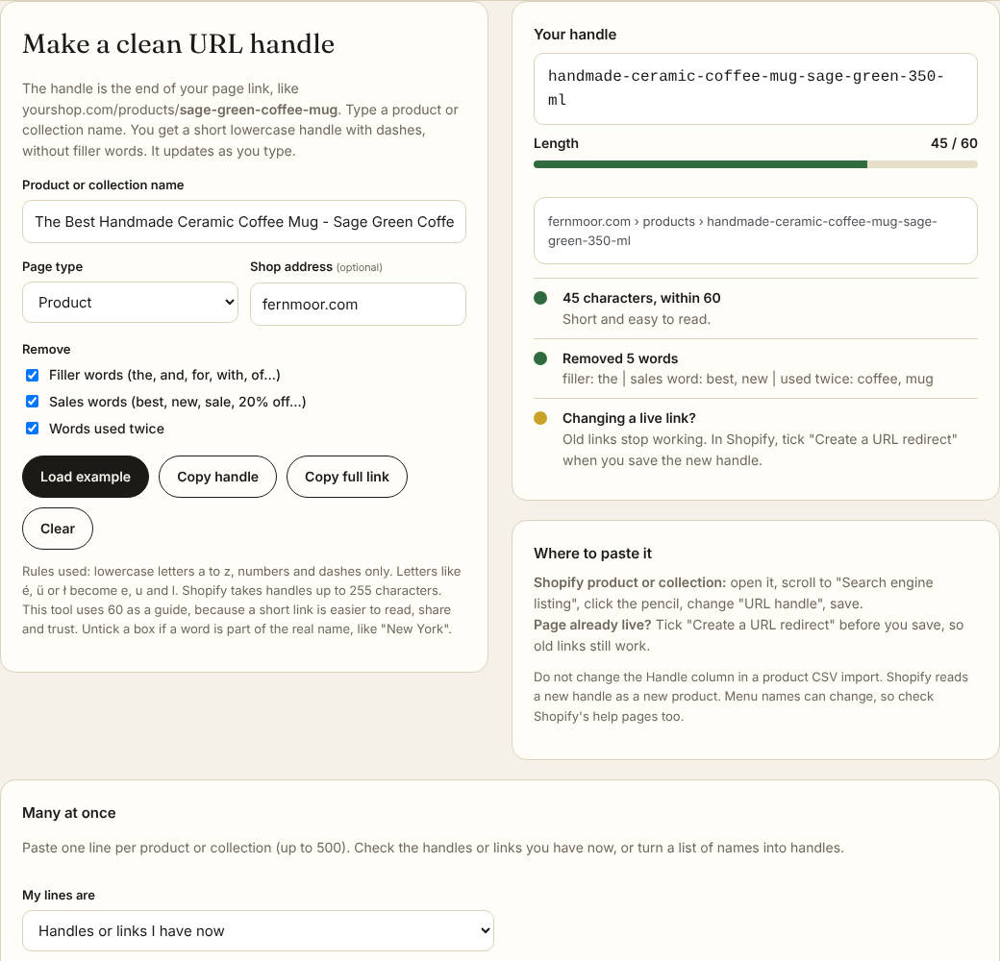
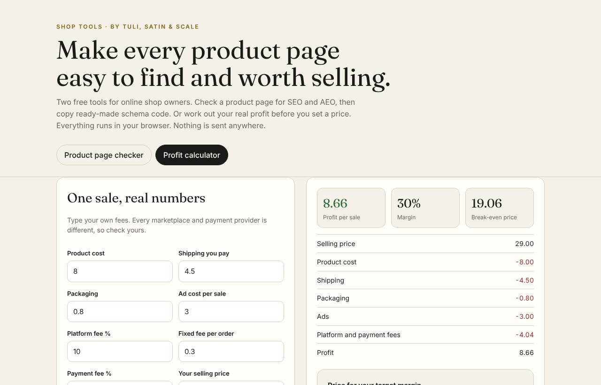

# Shop Tools

**Free tools for online shop owners. Check a product page for SEO and AEO, check if your titles fit Etsy, eBay and Google (one title or a whole list), check your 13 Etsy tags, write alt text for your product photos, make clean URL handles, and see your real profit per sale.**

**Live demo:** https://legacyroar7-maker.github.io/shop-tools/

## What it does

### 1. Product page checker (SEO + AEO)
Paste your product name, keyword, SEO title, meta description, description and FAQ. You get:

- **A score out of 100** with a clear list of what to fix first
- **SEO checks:** title and meta length, keyword in the right places, no keyword stuffing
- **Sales checks:** enough detail, short sentences, bullet points, real facts and numbers
- **AEO checks:** questions and answers that AI assistants (like ChatGPT) can quote, with direct first sentences
- **A Google preview** of how the page looks in search results
- **Ready-made schema code** (Product + FAQPage, JSON-LD) to paste into Shopify or any shop

### 2. Marketplace title checker
Type or paste a product title. Live character counts show if it fits:

| Where | Limit | What happens if it is longer |
|---|---|---|
| Etsy title | 140 characters | Etsy will not accept it |
| eBay title | 80 characters | eBay will not accept it |
| Shopify SEO title | about 60 characters | Google usually cuts the end |
| Meta description | about 155 characters | Google usually cuts the end |

The part that does not fit is shown crossed out, so you see exactly which words buyers lose. You also get quick fixes: extra spaces, too many words in CAPITALS (Etsy allows 3), symbols used twice (Etsy allows % : & + once each), repeated words, and a look at your first 40 characters.

Tip: put the product type and the words buyers search for first. Limits can change, so check your platform's help pages too.

### 3. Bulk title checker
Paste many titles at once, one per line (up to 500). Pick the limit: Etsy 140, eBay 80, Shopify SEO title about 60, or your own number. Each title gets a row that shows:

| Check | What it flags |
|---|---|
| Too long | How many characters are over the limit. The extra part is crossed out. |
| Repeated words | Words used twice or more, like "mug (3x)". Repeats waste space. |
| CAPITALS | A whole title in capital letters, or more than 3 words in capitals (Etsy allows 3). |
| Extra spaces | Spaces at the start, at the end or double spaces. They count as characters. |
| Same title twice | Two listings with the same title, so buyers cannot tell them apart. |

You also get a count of titles that need a fix, a filter to show only those, and a **Download results (CSV)** button to work through the list in a spreadsheet.

How to use it with your shop:

1. Export your products (Shopify: Products > Export. Etsy: Settings > Options > Download data. eBay: Seller Hub > Reports > Downloads).
2. Open the file and copy the title column.
3. Paste it into the bulk checker and pick your platform.
4. Fix the rows marked in red first, starting with titles that are too long.

### 4. Etsy tag checker
Paste your tags, one per line or with commas between them. Add your listing title too (optional). Each tag gets a row with what to fix:

| Check | What it flags | Colour |
|---|---|---|
| Too long | Tags over 20 characters. The extra part is crossed out. | Red: Etsy will not take it |
| Characters not allowed | Symbols like & / # ! . Use letters, numbers and spaces. An apostrophe or hyphen is fine inside a tag, not as the first character. | Red |
| Same tag twice | A repeat wastes one of your 13 slots. | Red |
| More than 13 tags | Etsy takes 13. Rows after 13 are marked. | Red |
| One word only | A 2 or 3 word phrase, like "sage green mug", is closer to what buyers type. | Gold: a tip |
| Only repeats the title | Every word is already in your title. Allowed, but the slot could add a style, an occasion or who it is for. | Gold: a tip |

At the top you see tags used out of 13, how many need a fix and how many free slots are left. **Copy tags for Etsy** copies up to 13 tags that pass the rules, with extra spaces and repeats removed, separated by commas. Paste them into the Tags box of your listing.

How to use it with your shop:

1. Open a listing in Etsy (Shop Manager > Listings) and copy its tags and title.
2. Paste them into the tag checker.
3. Fix the red rows first, then fill any free slots.
4. Use the gold tips to swap weak tags for phrases buyers type: style, occasion, who it is for, material.

Rules used come from Etsy's help pages: up to 13 tags, up to 20 characters each. Platforms change their rules, so check Etsy's help pages too.

### 5. Alt text helper
Alt text is the short line that tells shoppers who use a screen reader what is in a photo. Search engines and AI tools read it too. It is often left empty or filled with the file name.

Fill in the product once: product type, colour, material, and if you want, brand, size, a key detail and a scene. Tick the photos you have. You get one short alt text line per photo, ready to copy:

| Photo | Demo alt text (made-up brand Fernmoor) |
|---|---|
| Main photo | Fernmoor sage green stoneware coffee mug with speckled glaze |
| Side view | Side view of a sage green stoneware coffee mug with speckled glaze |
| Close-up of a detail | Close-up of the speckled glaze on a sage green coffee mug |
| In use | A sage green stoneware coffee mug filled with coffee on a wooden breakfast table |
| In a hand | A sage green stoneware coffee mug held in a hand to show its size |
| Size | Size of the sage green coffee mug: 350 ml, 9 cm tall |

Also in the list: back view, packaging, label close-up and on a model (for clothing and jewellery). You can edit every line, and each line is checked as you type:

| Check | What it flags | Colour |
|---|---|---|
| Too long | Over 125 characters. Shopify suggests 125 or fewer. Etsy takes up to about 250. | Red |
| File name | Text like IMG_4021.jpg instead of words. | Red |
| Keyword stuffing | The same word 3 times or more. | Red |
| "Photo of" at the start | Screen readers already say it is an image. | Gold: a tip |
| Very short | Fewer than 3 words. Add colour, material or what the photo shows. | Gold: a tip |
| Sales words | "Sale", "best", "buy now" and similar. Describe the photo, not the offer. | Gold: a tip |
| CAPITALS, emoji, hashtags | Screen readers may read them out letter by letter or by name. | Gold: a tip |
| Same text twice | Two photos with the same line. Say what is different in each photo. | Gold: a tip |

**Check alt text you already have:** paste your current alt text, one per line (up to 200), and get the same checks for each line.

How to use it with your shop:

1. Open the live page and pick the **Alt text helper** tab.
2. Fill in the product and tick the photos you have.
3. Read each line next to the real photo. Edit any line that does not match what the photo shows.
4. Paste each line into your shop. Shopify: Products, open the product, click the photo, add alt text, save. Etsy: Shop Manager, Listings, open the listing, click the photo, fill in "Alt text", press Apply.

Good alt text helps people who cannot see the photo, and gives search engines and AI tools clear words about your product. It does not promise a higher ranking. Limits come from Shopify's and Etsy's help pages, and platforms change their rules, so check them too.

### 6. URL handle maker (new)
The handle is the end of a page link: yourshop.com/products/**sage-green-coffee-mug**. Shopify builds it from your first product name, so it often stays long, messy or full of sales words like "new" or "sale" long after the sale ends.

Type a product or collection name. You get a clean handle as you type:

| Step | What the tool does |
|---|---|
| Lowercase and dashes | Capitals become lowercase, spaces and symbols become one dash. |
| Letters like é, ü, ł | Changed to e, u, l, so the link stays readable when it is shared. |
| Filler words | Takes out the, and, for, with, of and similar words. |
| Sales words | Takes out best, new, sale, "20% off" and "free shipping". |
| Words used twice | Keeps each word once. |
| Length | Shows the count out of 60. If it is longer, you get a shorter version cut at a whole word. |

Demo with made-up brand Fernmoor:

| Product name | Handle |
|---|---|
| The Best Handmade Ceramic Coffee Mug - Sage Green Coffee Mug, 350 ml (NEW!) | handmade-ceramic-coffee-mug-sage-green-350-ml |
| Linen Shirt - Blue - 20% OFF - Free Shipping | linen-shirt-blue |
| Crème Brûlée Scented Candle | creme-brulee-scented-candle |

Untick a box when a word is part of the real name, like "New York". You also see a link preview with your shop address and can copy the handle or the full link.

**Many at once:** paste up to 500 lines. Check the handles or links you have now, or turn a list of names into handles. Each line gets a suggested handle and what to fix:

| Check | What it flags | Colour |
|---|---|---|
| Over 60 characters | Shopify takes up to 255, but a short link is easier to read, share and trust. | Red |
| Capitals, spaces, symbols | Anything that is not a to z, 0 to 9 or a dash, like _ or &. | Red |
| Dashes | Two dashes in a row, or a dash at the start or end. | Red |
| Same handle twice | Each page needs its own handle. | Red |
| Ends with -1 or -copy | Shopify adds this when a handle is taken, often after you copy a product. | Gold: a tip |
| Filler or sales words | Words you can usually leave out. | Gold: a tip |
| A year | Like 2025. It can make the link look old later. | Gold: a tip |

**Download results (CSV)** gives you the list with suggested handles to work through.

How to use it with your shop:

1. Open the live page and pick the **URL handle maker** tab.
2. Type the product or collection name and pick the page type.
3. Read the handle. Untick a box if it took out a word you need.
4. In Shopify, open the product or collection, go to "Search engine listing", click the pencil and paste the new "URL handle".
5. If the page is already live, tick **Create a URL redirect** before you save, so old links and bookmarks still work.

Do not change the Handle column in a product CSV import. Shopify reads a new handle as a new product.

A clean handle makes a link easier to read, share and trust, and gives search engines and AI tools clear words about the page. It does not promise a higher ranking. Shopify's menu names and rules can change, so check its help pages too.

### 7. Profit calculator
Type your product cost, shipping, packaging, ads and fees. You get:

- Profit per sale and margin
- Break-even price
- The exact price you need for your target margin

## Why I built it
Most shop owners guess. They write product pages without checking them, and they set prices without counting every fee. This tool makes both checks take one minute.

## Privacy
Everything runs in your browser. No sign-up, no tracking, nothing is sent to a server.

## Tech
One HTML file, plain JavaScript, no frameworks, no build step. Hosted free on GitHub Pages. Works on phones.

## Use it
Open the live demo, press **Load example** to see how it works, then paste your own page.

---
Built by **Tuli, Satin & Scale**. I build Shopify stores, write product pages with SEO and AEO, make AI product videos and build web apps for shops.

Want this done for your shop or deck? I do it as a fixed-price project on Upwork: [Hire me on Upwork](https://www.upwork.com/freelancers/~01c18d191d6a95988c)
